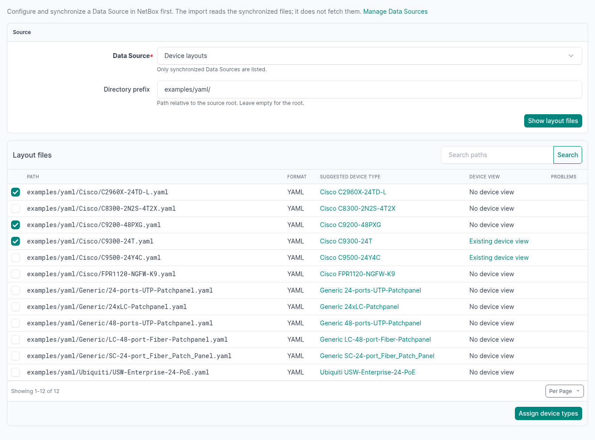
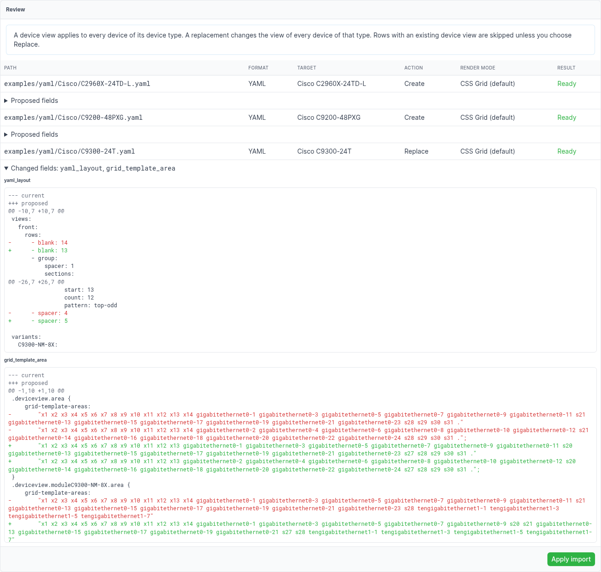
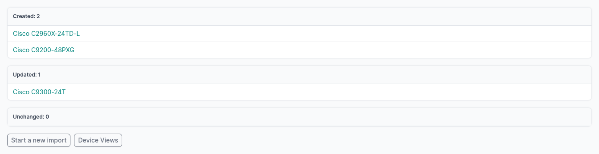

# Import from a Data Source

You can import YAML and CSS layouts from a NetBox Data Source into device views. You select the layout files and check the device types. Then you review the changes and apply them in one step.

The plugin does not fetch files. NetBox's native Data Sources clone the repository and keep the files. The plugin has no Git client, no sync job and no credential storage.

---

## Set up the Data Source

1. In NetBox, go to **Operations → Integrations → Data Sources**.
2. Click **Add**.
3. Set **Type** to **Git**.
4. Set **URL** to the repository, for example `https://github.com/peterbaumert/netbox-device-view.git`.
5. Optional: set **Branch**. For a private repository over HTTPS, set **Username** and **Password**. NetBox keeps these values. The plugin does not read them.
6. Save the Data Source.
7. Click **Sync**. The NetBox background worker (`rqworker`) runs the synchronization.

When the status is **Completed**, you can import from the Data Source. The import accepts all enabled Data Sources that have a completed synchronization, for example also a **Local** directory on the NetBox server.

### The Git backend's optional dependency

NetBox's Git backend uses the Python package [`dulwich`](https://www.dulwich.io/). NetBox lists it as an optional library for remote data sources. The official NetBox Docker image includes it. For other installations, do these steps:

1. Add `dulwich` to the local requirements of NetBox:

    ```bash
    sudo sh -c "echo 'dulwich' >> /opt/netbox/local_requirements.txt"
    ```

2. Install it in the NetBox virtual environment:

    ```bash
    source /opt/netbox/venv/bin/activate
    pip install dulwich
    ```

3. Restart the NetBox services and the `rqworker`.

---

## Directory conventions

The import reads the files below a **directory prefix**. The prefix is a path relative to the root of the Data Source. The default prefix is `examples/`. For a repository that holds only layouts, use an empty prefix.

The prefix matches whole path components: `examples/` includes `examples/yaml/Cisco/C9300-24T.yaml`, but not `examples-old/C9300-24T.yaml`.

| File suffix | Format |
|---|---|
| `.yaml`, `.yml` | [YAML layout](layout-yaml.md) |
| `.css` | [CSS layout (legacy)](layout-css.md) |

The catalog shows only these files.

Use the path `Manufacturer/Model.<suffix>` or `Manufacturer/PartNumber.<suffix>` to get a device type suggestion. The parent directory must be exactly the name of a manufacturer. The import then compares the file name without its suffix with the device types of that manufacturer:

1. When the file name is exactly the model of a device type, the import suggests that device type.
2. Otherwise, when the file name is exactly the part number of one device type, the import suggests that device type. When several device types have that part number, the import suggests no device type.

The import compares only with the device types that you can view. An empty part number never matches. The comparison does not change case or punctuation. For all other files, you select the device type manually.

The [devicetype-library](https://github.com/netbox-community/devicetype-library) names many files after the part number. For example, `Cisco/C8300-1N1S-6T.yaml` matches the device type with the model `Catalyst 8300-1N1S-6T` because its part number is `C8300-1N1S-6T`. A layout repository that uses these file names gets suggestions for these device types.

This repository has a YAML and a CSS layout for some models, for example `examples/yaml/Cisco/C9300-24T.yaml` and `examples/Cisco/C9300-24T.css`. With the prefix `examples/`, both files match the same device type, and the catalog marks them as ambiguous. This also applies when one file matches by model and another file matches by part number. You can use one of them, but you must then select its device type manually. To see only the YAML layouts, use the prefix `examples/yaml/`.

---

## Required permissions

| Task | NetBox permission |
|---|---|
| Open the **Device Views** list | `view` on Device View |
| See the **Import from Data Source** button and pages | `add` or `change` on Device View |
| Select a Data Source | `view` on Data Source |
| See its layout files | `view` on Data File |
| Select a device type | `view` on Device Type and on its Manufacturer |
| Create a device view | `add` on Device View |
| Replace a device view | `view` and `change` on Device View |
| Synchronize the Data Source | `sync` on Data Source. This is NetBox's own permission. The import does not need it. |

Object permission constraints apply to the existing record and to the record after the change. For example, a user can have the `add` permission only for some device types. If that user imports a layout for a different device type, apply rejects the import.

---

## Example: create and update several device views

This example imports two new layouts and replaces one existing layout in one import. The Data Source is a clone of this repository.

### 1. Select the files

1. On **Device Views**, click **Import from Data Source**.
2. Select the Data Source.
3. Set the prefix to `examples/yaml/`.
4. Click **Show layout files**.
5. Select the files to import. You can select files on several pages and in several searches. The selection stays when you change the page or the search.
6. Click **Assign device types**.

The catalog shows each file with its format and its suggested device type. It also shows if that device type has a device view.



### 2. Check the device types and choose Replace

The next page shows a device type for each file. If a suggestion is wrong or missing, select the correct device type.

The import skips a row whose device type has a device view, unless you select **Replace**. In this example, `C9300-24T` has a device view, and the repository has a newer layout for it. Select **Replace** for this row.

Click **Review**.

### 3. Review the changes

For each row, the review shows the action, the render mode and the validation result. For a replacement, it shows the changed fields as a text difference. A field with more than 1000 lines in the current and the proposed text together shows no difference, only a note that it is too large. The review shows the layout as text only. It does not show a preview of the layout.



A device view applies to all devices of its device type. A replacement changes the view of all devices of that type.

If a row has an error, the import cannot apply any row. Correct the selection, then click **Review** again.

If the Data Source starts to synchronize during the review, the review stops and shows an error. Click **Review again** when the synchronization is complete.

### 4. Apply

Click **Apply import**. The import writes all rows in one database transaction, or no row. The result lists the created, updated and unchanged device views.



The change log of each device view records the import as a usual create or update.

---

## Update device views later

A synchronization of the Data Source refreshes the available files. It never changes a device view. The import copies the layout into the device view. It does not link the device view to the file.

To update device views after a change in the repository:

1. Click **Sync** on the Data Source.
2. Import the changed files again, and select **Replace**.

If a file has the same layout as the device view, the result is **Unchanged**. The import then does not change the device view or its change log. The comparison and the text difference ignore line endings and the whitespace at the start and end of each field. Thus a device view that you saved in its edit form, which strips the fields and can store CRLF line endings, does not show as changed.

---

## What the import checks

- **Content:** YAML layouts must pass the [YAML layout](layout-yaml.md) validation. The import also rejects a YAML layout when:
    - the cells of a key do not make one rectangle in a view, or in a variant together with its view. Overlapping elements are the usual cause;
    - it has variants and both a front and a rear view;
    - a variant names a view that is not in `views`.

    CSS layouts can contain only the grid rules that the plugin renders:
    - selectors: one compound class selector with `.deviceview.area`, and optionally one module class and `.dFront` or `.dRear`;
    - `grid-template-areas`: strings of area names or dots, with the same number of cells in each row; the cells of each area name must make one rectangle;
    - `grid-auto-rows` and `grid-auto-columns`: the value `auto` only;
    - `background` and `background-color`: one literal colour.

    The import rejects at-rules, nested rules, `!important`, URLs, custom properties and the characters `<` and `>`.
- **Size:** at most 256 KiB per file, 2 MiB and 100 files per import, 4096 cells per canvas, and 10000 expanded elements per layout.
- **Changes after the review:** a review is valid for 15 minutes, and only for the user who made it. Apply rejects the import and changes nothing when one of these occurs after the review:
    - a selected file changed or was deleted;
    - the Data Source was disabled or deleted, is synchronizing, or its last synchronization failed;
    - a different change created, deleted or moved a target device view;
    - a different change edited the layout fields or the render mode of a target device view;
    - a target device type got a different model name or manufacturer;
    - a permission that the import needs was removed.

    Then review the import again. If a different change already gave a target device view the same layout, the result for that row is **Unchanged**.
